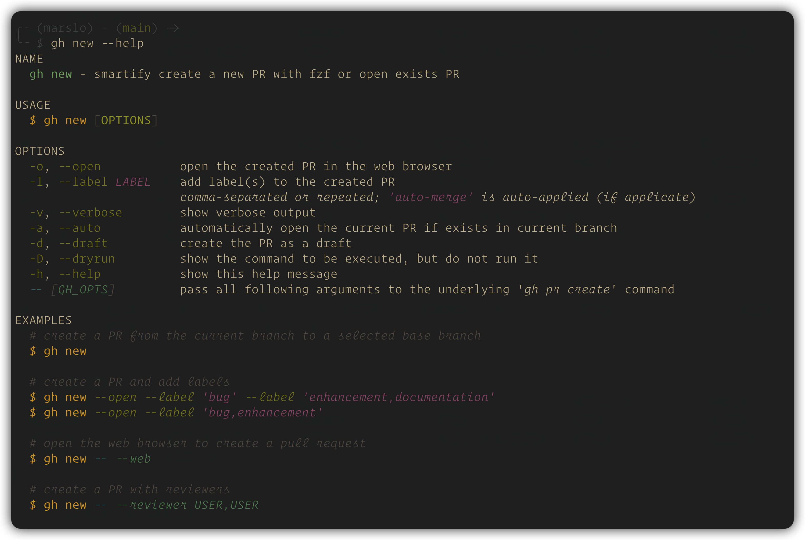

# gh-new

> A [GitHub CLI](https://cli.github.com/) extension for smartly creating Pull Requests with an interactive base branch picker powered by [fzf](https://github.com/junegunn/fzf).

---

[](https://github.com/marslo/gh-new/actions/workflows/pre-commit.yml)


---

## features

- **Interactive base branch selection** — picks from remote branches sorted by most recent commit, with a live `git show` preview
- **Auto-push** — detects if the current branch hasn't been pushed (or is behind remote) and pushes it before creating the PR
- **Auto-title & body** — title from the latest commit subject; body from every commit between base and current branch
- **AI title for multi-commit PRs** — summarizes all commits into one conventional-commit title via `claude -p`, e.g. `feat(ABC-123,api,cli): …` ( single line, ≤ 120 chars; JIRA IDs only when the commit scopes have any ); falls back to the latest commit subject when `claude` is missing, fails or returns an invalid title
- **`auto-merge` label** — automatically applied if the label exists in the repo
- **Label management** — add multiple labels via comma-separated values or repeated flags
- **Draft support** — create the PR as a draft
- **Pass-through** — forward any extra flags directly to `gh pr create`

---

## requirements

| TOOL                                   | VERSION |
|----------------------------------------|---------|
| [gh](https://cli.github.com/)          | ≥ 2.36  |
| [fzf](https://github.com/junegunn/fzf) | ≥ 0.60  |
| bash                                   | ≥ 4.0   |

> [!NOTE]
> Optional: [Claude Code](https://docs.anthropic.com/en/docs/claude-code) CLI ( `claude` ) for the AI title of multi-commit PRs. `timeout` / `gtimeout` ( coreutils ) enforces `GH_NEW_AI_TIMEOUT` when available.

---

## installation

```bash
gh extension install marslo/gh-new
```

## setup (submodules + bash completion)

```bash
gh new --setup
```

```bash
# `--force` re-install
gh new --setup --force
```

## bash completion

`--setup` prints the two lines you need to add to `~/.bashrc` (order matters):

```bash
# 1. gh native completion must be sourced first
eval "$(gh completion -s bash)"
# or: source /path/to/bash_completion.d/gh.bash.sh

# 2. gh-new completion wraps __start_gh — must come after
source "${BASH_COMPLETION_USER_DIR:-${HOME}/.local/share/bash-completion}/gh-ext.bash.sh"
```

---

## usage



```
gh new [OPTIONS]
```

### options

| FLAG                  | DESCRIPTION                                                                                       |
|-----------------------|---------------------------------------------------------------------------------------------------|
| `-o`, `--open`        | Open the created PR in the browser                                                                |
| `-l`, `--label LABEL` | Add label(s) — comma-separated or repeated; `auto-merge` is auto-applied if it exists in the repo |
| `-v`, `--verbose`     | Show verbose output                                                                               |
| `-a`, `--auto`        | If a PR already exists for the current branch, open it instead of creating a new one              |
| `-d`, `--draft`       | Create the PR as a draft                                                                          |
| `-D`, `--dryrun`      | Print the command without executing it                                                            |
| `--no-ai`             | Skip the `claude -p` title for multi-commit PRs; use the latest commit subject                    |
| `-h`, `--help`        | Show help                                                                                         |
| `--` `GH_OPTS`        | Pass remaining args to `gh pr create` (e.g. `--web`, `--reviewer`)                                |

---

## examples

```bash
# interactively pick a base branch and create a PR
gh new

# create a PR and open it in the browser
gh new --open

# create a PR and add labels
gh new --open --label 'bug' --label 'enhancement,documentation'
gh new --open --label 'bug,enhancement'

# open the browser form to create a PR (gh native web mode)
gh new -- --web

# create a PR with reviewers
gh new -- --reviewer USER1,USER2

# create a draft PR
gh new --draft

# if a PR already exists for the current branch, open it
gh new --auto

# dry-run to inspect the gh command before running
gh new --dryrun

# multi-commit PR: keep the latest commit subject as the title ( no AI )
gh new --no-ai

# AI title with another model and a longer timeout
GH_NEW_AI_MODEL=sonnet GH_NEW_AI_TIMEOUT=120 gh new
```

## fzf Key Bindings (inside the base branch picker)

| KEY      | ACTION                                                 |
|----------|--------------------------------------------------------|
| `ctrl-o` | Toggle between summary and full diff preview           |
| `ctrl-/` | Cycle preview window position (right → top → hidden)   |
| `ctrl-y` | Copy the base branch's latest commit hash to clipboard |

---

## workflow

```
gh new
  ↓
auto-push current branch if not pushed or behind remote
  ↓
fzf: pick base branch (sorted by most recent commit, with git show preview)
  ↓
title: 1 commit → its subject
       2+ commits → `claude -p` summary ( fallback: latest subject; skip with --no-ai )
  ↓
gh pr create --base <selected> --head <current> --title <title> --body <all commit messages>
  ↓
add labels (skip 'auto-merge' if already applied, warn if label not found)
  ↓
open PR in browser (if --open)
```

---

## configuration

| VARIABLE                   | PURPOSE                                              |
|----------------------------|------------------------------------------------------|
| `FZF_DEFAULT_OPTS`         | Global fzf options (colours, layout, keybindings, …) |
| `BASH_COMPLETION_USER_DIR` | Where `--setup` installs the completion script       |
| `GH_NEW_AI_MODEL`          | `claude` model for the AI title ( default: `haiku` ) |
| `GH_NEW_AI_TIMEOUT`        | AI title timeout in seconds ( default: `60` )        |

---

## License

MIT
